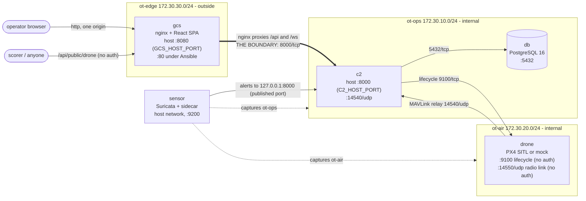

# Vulnerable Drone PX4 Lab

[](https://github.com/teodoramz/Vulnerable-Drone-PX4-Lab/actions/workflows/ci.yml) [](LICENSE)    

A vulnerable-by-design drone and OT security training lab. One surveillance drone, Sentinel, patrols Marwick International Airport (15,793 authored objects, 9.97 km2 operational area). Attackers try to bring the aircraft down; defenders find out how from the audit log, the inventory and the IDS.

[](docs/OPERATOR-GUIDE.md)

How to fly it and investigate a loss, with screenshots: [docs/OPERATOR-GUIDE.md](docs/OPERATOR-GUIDE.md). The scenario: [docs/SCENARIO.md](docs/SCENARIO.md).

## Components

| Component | Role |
|---|---|
| `gcs` | React + Leaflet ground station served by nginx, which proxies `/api` and `/ws` to the C2 |
| `c2` | FastAPI mission server: auth, RBAC (admin / operator / observer), audit log, fleet engine |
| `drone` | PX4 SITL (SIH, real firmware) or a mock autopilot; both speak MAVLink 2 |
| `db` | PostgreSQL 16 |
| `sensor` | Suricata plus a live traffic tap; 27 custom rules (sids 9000001-9000032) |

Details: [docs/ARCHITECTURE.md](docs/ARCHITECTURE.md), [docs/SIMULATION.md](docs/SIMULATION.md) (drone backends), [docs/MONITORING.md](docs/MONITORING.md) (sensor and ruleset).

## Infrastructure

Three segments (`edge`, `ops`, `air`); exactly one flow crosses the boundary (`gcs` to `c2:8000`).



Details: [docs/INFRASTRUCTURE.md](docs/INFRASTRUCTURE.md) (port matrix, layouts, configuration).

## Vulnerabilities

- [x] Unauthenticated MAVLink radio link (`14550/udp`): commands, position, GPS, missions, parameters
- [x] No MAVLink rate limiting
- [x] Guessable JWT secret: forged tokens
- [x] Known console passwords, no login rate limiting
- [x] Broad data exposure to admin tokens
- [x] Unauthenticated drone lifecycle API (`9100/tcp`)
- [x] IDS alerts relayed through the C2, so a C2 compromise can hide them
- [x] Operational area enforced by the C2 only
- [x] Unauthenticated status API (`/api/public/drone`)
- [ ] Stored XSS in a mission or callsign field
- [ ] SQL injection in a search
- [ ] Firmware update without a signature check
- [ ] API key hard-coded in the frontend bundle
- [ ] Verbose error pages leaking stack traces
- [ ] Camera stream over unauthenticated RTSP
- [ ] Default SSH credentials on a companion computer

Details: [docs/SECURITY.md](docs/SECURITY.md), [docs/PUBLIC-API.md](docs/PUBLIC-API.md).

Losing the drone is always reported as signal lost with a last known position, never as a crash. The cause is deduced from the audit log plus the inventory.

Details: [docs/ATTACKS.md](docs/ATTACKS.md).

## Quick start

```bash
cp env.example .env
docker compose up -d --build                                                    # PX4; first build 20-40 min
docker compose -f docker-compose.yml -f docker-compose.mock.yml up -d --build   # mock; about 2 min
```

| | docker compose | Ansible |
|---|---|---|
| Console | `http://localhost:8080` (`GCS_HOST_PORT`) | `http://<host>/` (port 80, `drone_lab_console_port`) |
| API | `:8000` (`C2_HOST_PORT`) | `:8000` |

Accounts `admin`, `operator`, `observer`, all with password `Admin1Admin1` (`ADMIN_PASSWORD`, `OPERATOR_PASSWORD`, `OBSERVER_PASSWORD`). Admin can do everything; operator can fly and read the audit log; observer only watches.

Details: [docs/GETTING-STARTED.md](docs/GETTING-STARTED.md).

Single-host Ansible deploy:

```bash
cd ansible
cp inventory.yml.example inventory.yml    # edit; gitignored (holds SSH/sudo passwords)
ansible-playbook site.yml
```

Details: [ansible/README.md](ansible/README.md).

## Documentation

| Doc | Content |
|---|---|
| [docs/GETTING-STARTED.md](docs/GETTING-STARTED.md) | Prerequisites, accounts, first flight, ports, configuration, troubleshooting |
| [docs/OPERATOR-GUIDE.md](docs/OPERATOR-GUIDE.md) | The console, with screenshots: flying, losing the drone, investigating |
| [docs/SCENARIO.md](docs/SCENARIO.md) | Site, routes, flying, losing the drone, maintenance reset |
| [docs/ATTACKS.md](docs/ATTACKS.md) | Attack runbook and blue-team detection |
| [docs/SECURITY.md](docs/SECURITY.md) | Vulnerabilities, full toolkit, mitigations |
| [docs/MONITORING.md](docs/MONITORING.md) | Sensor, ruleset, Network tab, SIEM |
| [docs/PUBLIC-API.md](docs/PUBLIC-API.md) | Unauthenticated status endpoint |
| [docs/INFRASTRUCTURE.md](docs/INFRASTRUCTURE.md) | Segments, port matrix, deployment layouts, configuration |
| [docs/ARCHITECTURE.md](docs/ARCHITECTURE.md) | Software design, state machine, development workflow |
| [docs/SIMULATION.md](docs/SIMULATION.md) | PX4 and mock backends, behaviour under attack |
| [ansible/README.md](ansible/README.md) | Ansible deployment and variables |
| [tools/README.md](tools/README.md) | Attack toolkit |
| [assets/README.md](assets/README.md) | Map source |

## Tests

```bash
cd services/c2     && pytest
cd services/drone  && pytest
cd services/sensor && pytest
cd services/frontend && npm install && npm run build
python3 scripts/check-kit-parity.py
python3 scripts/check-ids-contract.py
```

CI runs the same on every push: `.github/workflows/ci.yml`.

Details: [docs/ARCHITECTURE.md](docs/ARCHITECTURE.md#development).

## Features

- [x] PX4 SITL (real firmware, SIH) or a lightweight mock autopilot
- [x] Web ground station: live map, telemetry, go-to, patrol routes, manual stick
- [x] Airport with 15,793 objects; collisions and boundary breaches lose the drone
- [x] Accounts with roles (admin, operator, observer) and a claim lock
- [x] Audit log of every command and every loss
- [x] Site inventory with near-position search
- [x] Suricata IDS with 27 MAVLink and OT rules, shown live in the console
- [x] Flows, packets and pcap download in the Network tab
- [x] Attack toolkit, `tools/exploit.py`
- [x] Maintenance reset after an attack
- [x] Unauthenticated status API for scoring
- [x] Deploy with Docker Compose, Ansible, or one component per VM
- [x] CI: the test suites and the frontend build on every push
- [ ] Flight recorder: replay the last minutes of a flight on the map
- [ ] Incident timeline: audit entries, IDS alerts and telemetry in one view
- [ ] Harmless faults (battery, wind, GPS glitches) to tell apart from attacks
- [ ] Hardened mode: MAVLink 2 signing, rate limits, a strong JWT secret, to compare attacks
- [ ] Write and test Suricata rules from the console
- [ ] Geofence enforced on the drone itself
- [ ] Guided challenges, checked against the audit log and alerts
- [ ] Instructor view of every team's lab
- [ ] Scoreboard and flags
- [ ] Full lab reset between teams
- [ ] Swarm scenario (the engine already runs several drones with `DRONE_COUNT`)
- [ ] Prebuilt PX4 image, to skip the first build
- [ ] SIEM stack wired to `eve.json`
- [ ] Simulated camera feed

## License

[MIT](LICENSE), for this repository's code, map and data. Dependencies keep their own licenses; they are installed at build time, not bundled here. Notable ones: pymavlink (LGPL-3.0), react-leaflet (Hippocratic License 2.1), Suricata (GPL-2.0), PX4 (BSD-3-Clause).
