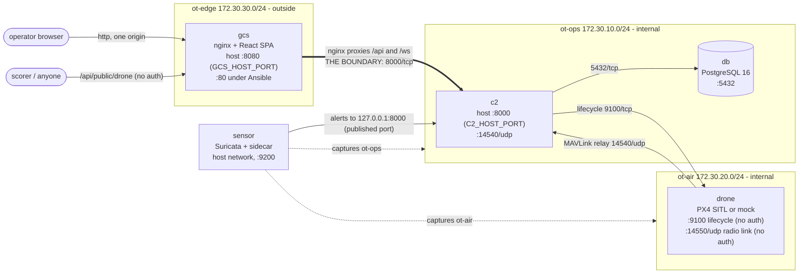

# Infrastructure and deployment

Five components on three network segments. Exactly one flow crosses the external/internal boundary: `gcs` to `c2:8000/tcp`.

<!-- README.md carries a copy of this diagram. -->


## Components

| Component | Role | Stack |
|---|---|---|
| `gcs` | Operator UI (map, controls, Network tab). nginx proxies `/api` and `/ws` to the C2 so the browser uses one origin. | React 18, Vite, TypeScript, Tailwind, react-leaflet, nginx |
| `c2` | Auth, RBAC, claim/lock, flight state machine, telemetry fan-out, audit log, IDS alert relay. No physics. | FastAPI, async SQLAlchemy 2, PyJWT, bcrypt, MAVSDK |
| `drone` | PX4 SITL (SIH) or MAVLink mock, plus a lifecycle agent | PX4, Python, pymavlink |
| `db` | Users, drone registry, missions, telemetry, audit log | PostgreSQL 16 |
| `sensor` | Suricata plus FastAPI sidecar watching both internal segments | Suricata, FastAPI |

## Segments

| Segment | Bridge | Subnet | Members |
|---|---|---|---|
| edge | `ot-edge` | 172.30.30.0/24 | `gcs` (.10) |
| ops | `ot-ops` | 172.30.10.0/24 | `c2` (.10), `db` (.20), `gcs` (.30) |
| air | `ot-air` | 172.30.20.0/24 | `drone` (.10), `c2` (.11) |

Bridges have fixed names so the sensor can capture on them from the host namespace. The pivot container uses `.66` on ops and air.

## Ports and firewall

Open each port only to the listed peer.

| Source | Destination | Port | Purpose |
|---|---|---|---|
| operators | `gcs` | `8080/tcp` (`80` under Ansible) | Web UI |
| anyone | `gcs` to `c2` | `/api/public/*` | Drone status, unauthenticated by design |
| `gcs` | `c2` | `8000/tcp` | REST + WebSocket, the only boundary crossing |
| `c2` | `db` | `5432/tcp` | PostgreSQL |
| `c2` | `drone` | `9100/tcp` | Lifecycle API, unauthenticated by design |
| `drone` | `c2` | `14540/udp` | MAVLink telemetry relay |
| anything on `ot-air` | `drone` | `14550/udp` | Radio link, unauthenticated by design |
| px4 | MicroXRCEAgent (inside `drone`) | `8888/udp` | Micro-XRCE-DDS, local to the drone container, unused by the C2 |
| `sensor` | `c2` | `8000/tcp` | Alert push |
| blue team / SIEM | `sensor` | `9200/tcp` | Alerts, out of band |

An attacker pivoting from the DMZ lands on `ot-ops` or `ot-air`, where the radio link and lifecycle API are both reachable.

## Layouts

### Single host: docker compose

```bash
cp env.example .env                  # set JWT_SECRET, ADMIN_PASSWORD, IDS_PUSH_TOKEN as needed
docker compose up -d --build         # PX4 backend; first build 20-40 min, cached in volume px4build
docker compose -f docker-compose.yml -f docker-compose.mock.yml up -d --build   # mock backend, about 2 min
```

First start clones and compiles PX4 (needs `github.com`). An interrupted fetch resumes on the next start; after 10 failed attempts the container exits, and restarting it retries.

Console `:8080` (`GCS_HOST_PORT`), API `:8000` (`C2_HOST_PORT`).

```bash
curl -s localhost:8000/health        # c2
curl -s localhost:9100/health        # drone agent
curl -s localhost:9200/health        # sensor
docker compose down                  # stop, keep volumes
docker compose down -v               # also wipe database and compiled PX4
```

### Single host: Ansible

`ansible-playbook site.yml` builds the archive on the controller, unpacks it to `/opt/drone-lab`, templates `.env` and the `drone-lab.service` unit, builds images and starts the service (diagram in `ansible/README.md`). Console on port 80 by default.

### One component per VM

Compose files in `deploy/`, one `.env` per host (`cp deploy/.env.example deploy/.env`). No file hard-codes a peer address. Start in dependency order:

```bash
docker compose --env-file .env -f db.compose.yml     up -d
docker compose --env-file .env -f drone.compose.yml  up -d --build   # first boot compiles PX4
docker compose --env-file .env -f c2.compose.yml     up -d --build
docker compose --env-file .env -f sensor.compose.yml up -d --build
docker compose --env-file .env -f gcs.compose.yml    up -d --build
```

`c2` seeds the database at boot, so `db` must be healthy first; `sensor` needs `c2` to push alerts; `gcs` needs only `c2:8000`.

Per-host settings:

- `SENSOR_IFACES`: `ot-ops,ot-air` exist only on a single Docker host. On a sensor VM set the NIC that receives mirrored traffic (`eth1` for SPAN, `eth0` inline).
- `C2_URL` (sensor): the sensor uses host networking and cannot resolve `c2`. Single host: `http://127.0.0.1:8000`. Multi-VM: `C2_HOST` is the C2's address on the ops segment.
- `CORS_ORIGINS`: the ground station's URL. `C2_UPSTREAM` (gcs): the C2's real address. The SPA uses relative paths, so no rebuild is needed; nginx renders the upstream at container start.

### Attaching to an existing range

1. `gcs` on the segment trainees browse from; it needs access only to the C2.
2. `c2`, `db`, `drone`, `sensor` on the internal segments. `drone` must be reachable on `14550/udp` from where the attacker sits.
3. One rule across the boundary: `gcs` to `c2:8000/tcp`; deny everything else.
4. Point the sensor at a mirror of the C2 and drone traffic, or run it on the drone host.
5. Forward alerts to your own tooling from `sensor:9200` or `eve.json` (`docs/MONITORING.md`).

## Configuration reference

Single host: `env.example`. Multi-VM: `deploy/.env.example`. Never commit a real `.env`.

| Variable | Used by | Purpose |
|---|---|---|
| `DRONE_BACKEND` | c2, drone | `px4` or `mock` |
| `DRONE_COUNT` | c2, drone | Fleet size (1 for this scenario) |
| `DRONE_HOST`, `DRONE_API_URL`, `DRONE_WS_URL`, `DRONE_MAVLINK_PORT` | c2 | Drone endpoints (relay port 14540) |
| `C2_HOST` | drone, gcs | Relay target / nginx upstream |
| `DB_HOST`, `POSTGRES_*` | c2, db | Database location and credentials |
| `HOME_ALT` | c2, drone | Pad elevation. Pad position comes from the site dataset. |
| `JWT_SECRET`, `ACCESS_TOKEN_EXPIRE_MINUTES` | c2 | Token signing and lifetime (720) |
| `ADMIN_*`, `OPERATOR_*`, `OBSERVER_*`, `SEED_DEMO_USERS` | c2 | Seeded accounts |
| `AUTO_PATROL`, `AUTO_PATROL_ROUTE`, `AUTO_PATROL_ALT` | c2 | Boot straight onto a patrol (default true, `perimeter`, 60 m) |
| `CORS_ORIGINS` | c2 | Allowed browser origins |
| `SENSOR_IFACES`, `C2_URL`, `IDS_PUSH_TOKEN` | sensor, c2 | Capture interfaces, alert push target, shared token |
| `EVE_PATH`, `IDS_BUFFER_SIZE`, `SENSOR_URL` | sensor, c2 | Suricata EVE log path, alerts held in memory (500), sensor address the C2 polls for flows |

Every interface is weak or unauthenticated by design (`docs/SECURITY.md`). Set `SEED_DEMO_USERS=false` to drop the operator and observer accounts. Never expose the stack to a network you do not control.
