# Operator guide

How to fly the drone from the console and how to work out what happened to it. The screenshots use the mock backend; PX4 looks the same. Flight rules and the loss model: [SCENARIO.md](SCENARIO.md).

## Sign in

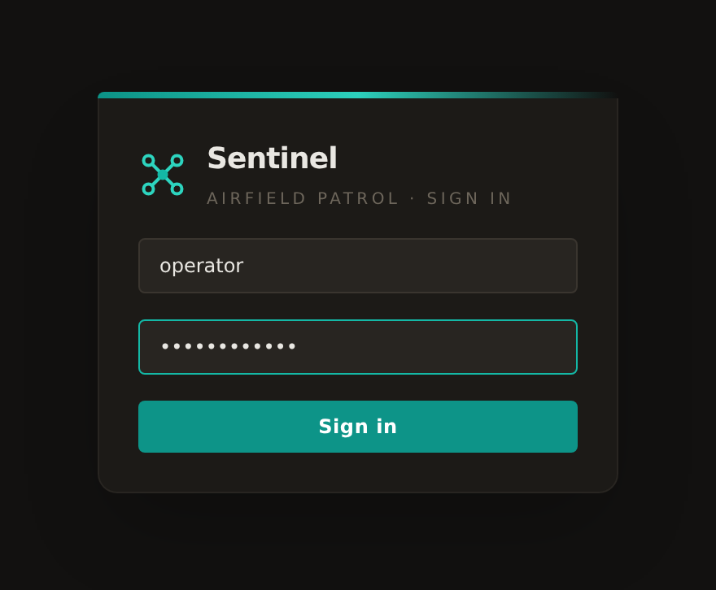

`admin`, `operator` or `observer`, all with password `Admin1Admin1`. Observers watch only; operators fly and read the audit log; admins can do everything. Details: [GETTING-STARTED.md](GETTING-STARTED.md#accounts).

## The console

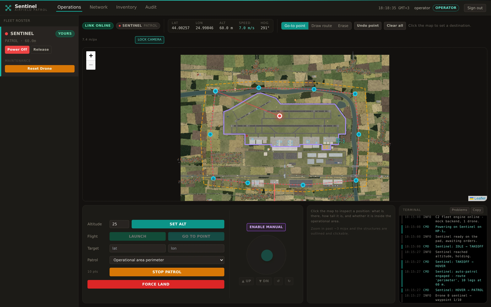

- Left: the fleet roster.
- Top: link and flight state, live telemetry, map tools.
- Centre: the site map, with the drone, its route and the operational area (dashed orange; leaving it loses the drone).
- Bottom: flight controls, manual stick, position inspector, terminal log.

At boot the C2 launches the drone on the perimeter patrol at 60 m.

## Take control

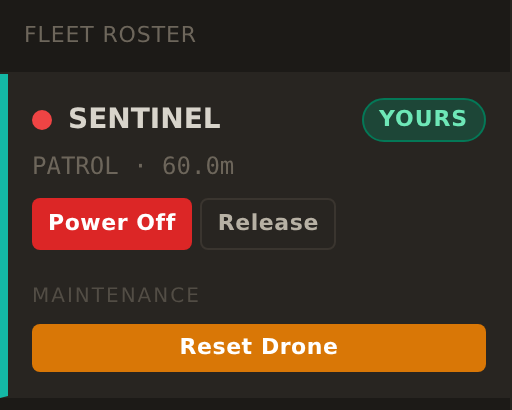

- **Claim** the drone before commanding it. **Power On** also claims it; pick the pad (HP-1 or HP-2) first.
- After power-on, wait for `IDLE` (30-40 s on PX4) before **LAUNCH**.
- Only the holder can command it. **Release** hands it back; an admin can **Force-release**.
- **Reset Drone** is the maintenance reset: it lands and power-cycles the drone, and puts a replacement on a pad after a loss.

## Read the status strip

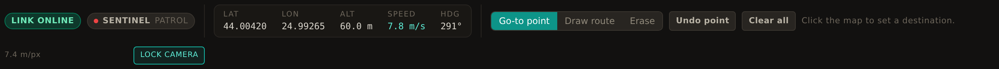

- `LINK ONLINE` is the console's connection to the C2; next to it are the callsign and flight state.
- Latitude, longitude, altitude, ground speed and heading update live.
- The map tools set what a map click does: **Go-to point**, **Draw route** or **Erase**.
- **LOCK CAMERA** follows the drone. Dragging or scrolling the map frees the view.

## Flight controls

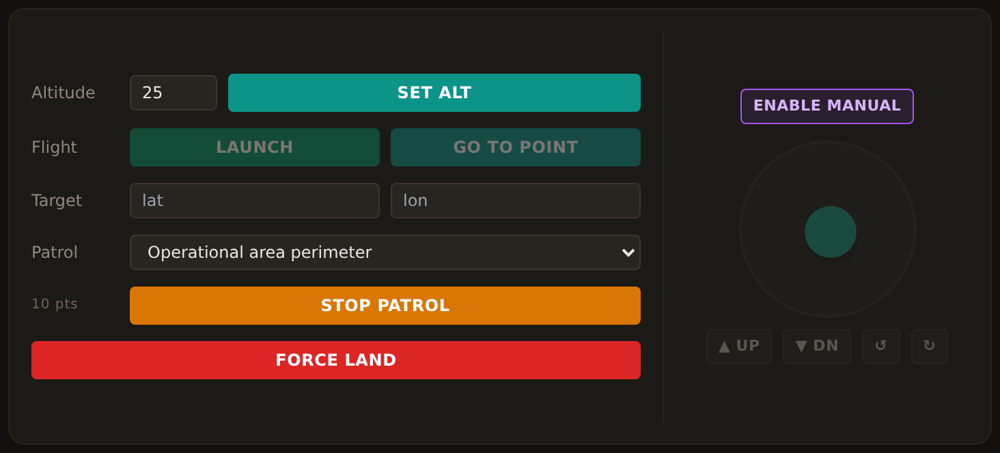

| Control | Effect |
|---|---|
| Altitude, **SET ALT** | One altitude for launch, transit and patrol. SET ALT applies it now, keeping the route or target. |
| **LAUNCH** | Take off to the altitude. |
| **GO TO POINT** / **CANCEL NAV** | Fly to the target, or abandon the leg. |
| Target | The destination; typing it or clicking the map sets the same value. |
| Patrol, **START PATROL** | Fly a predefined route, or the one drawn on the map. |
| **FORCE LAND** | Land where it is. |

The drone flies in a straight line at the set altitude. Set the altitude above anything on the way: the control tower is 45 m.

## Go to a point

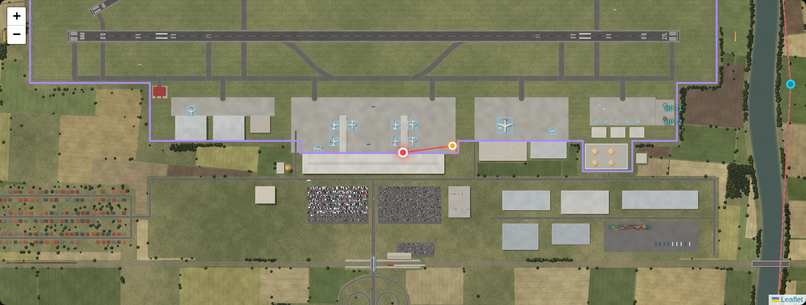

Choose **Go-to point**, click the map (or type the coordinates), then **GO TO POINT**. A line joins the drone to the target.

## Fly a route

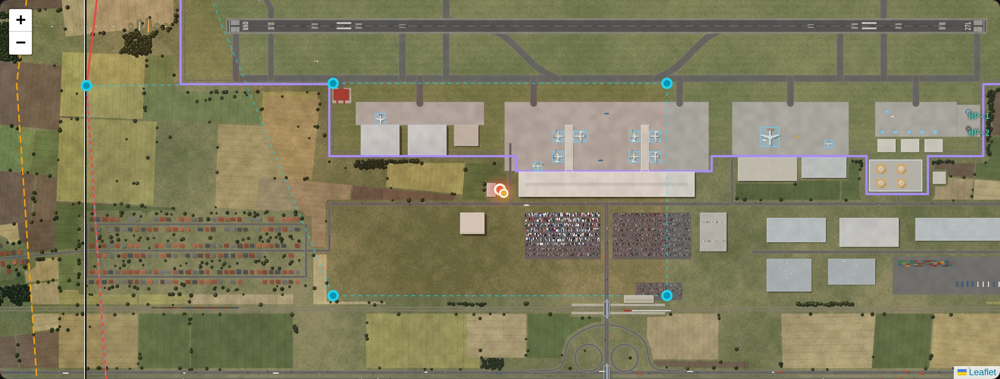

Pick a route under **Patrol**, or choose **Draw route** and click the waypoints. An unsent route is dashed. **Undo point**, **Erase** and **Clear all** edit it; **START PATROL** flies it.

## Manual control

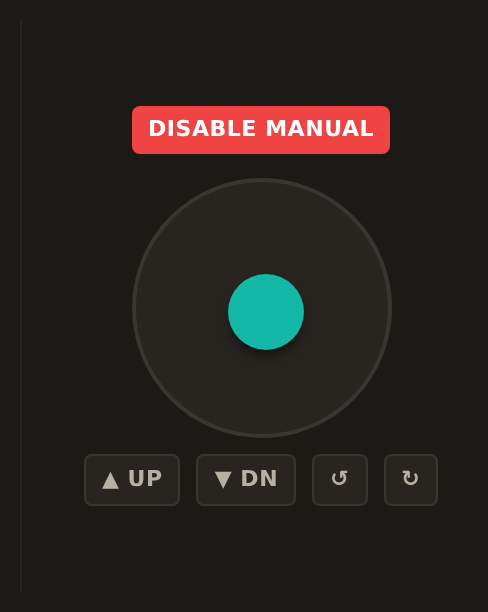

**ENABLE MANUAL**, then drag the stick to move. **UP** / **DN** climb and descend, **↺** / **↻** yaw. **DISABLE MANUAL** returns the drone to hover.

## Inspect the map

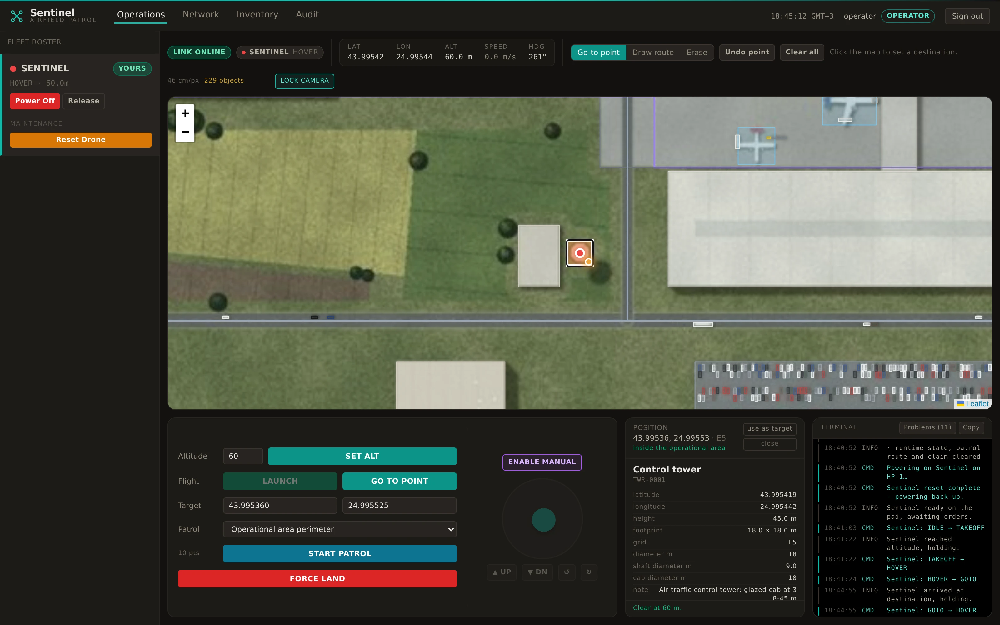

Zoom in past about 3 m/px and structures are outlined. Click a point to see what is there, its height, and whether the drone clears it at the current altitude. **use as target** copies the point into the Target boxes.

## When the drone is lost

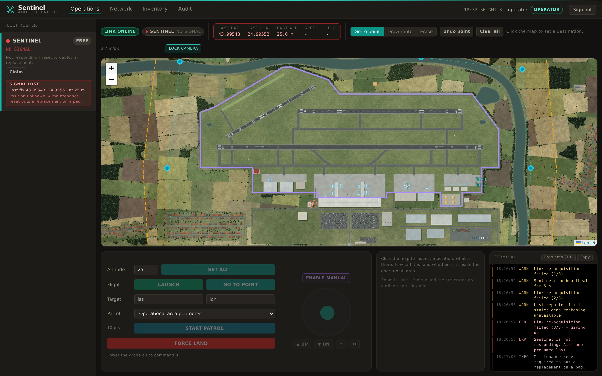

Contact stops and the console shows `NO SIGNAL` with the last fix; the map marks it with a dashed question mark. The console never says why. **Reset Drone** deploys a replacement on a pad.

## Investigate

**Network**: IDS alerts, with the frame that tripped each one.

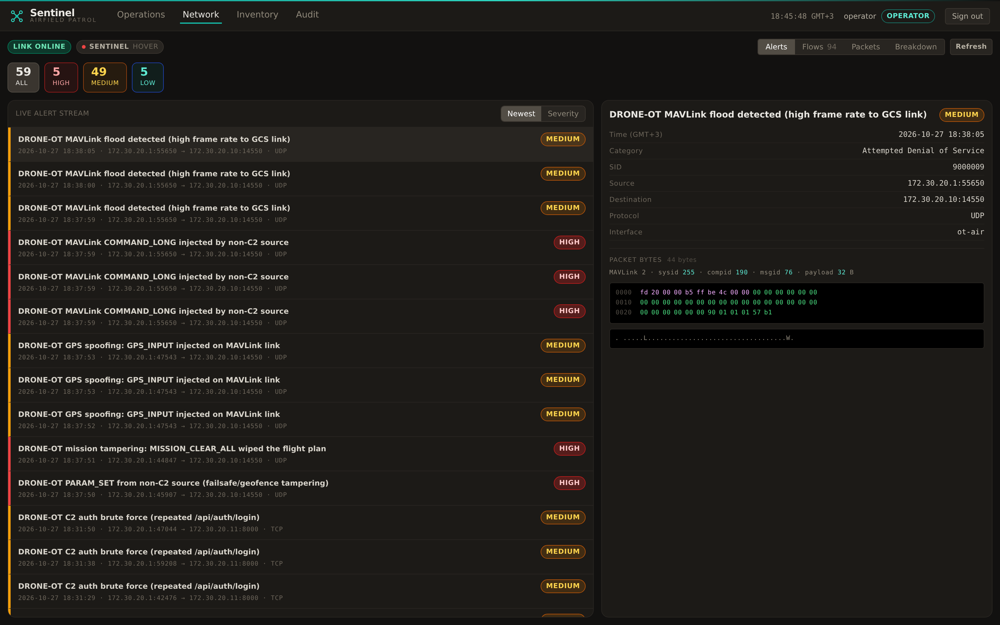

**Flows**: live traffic on both internal segments.

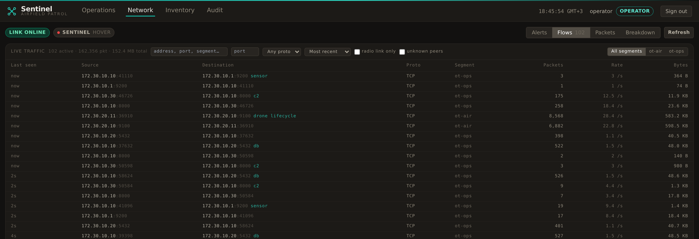

**Audit**: every command, who sent it, and the loss with its last fix. Here the drone was sent to the tower at 25 m.

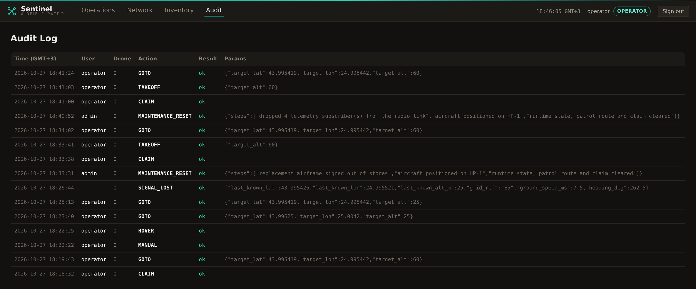

**Inventory**: paste the last fix into **Near position**. The 45 m control tower `at this point`, against a 25 m last altitude, is the cause.

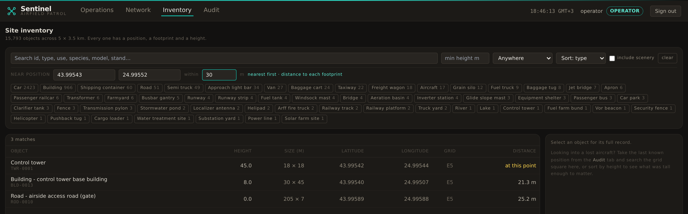

More: [ATTACKS.md](ATTACKS.md), [MONITORING.md](MONITORING.md).

## Manage users (admin)

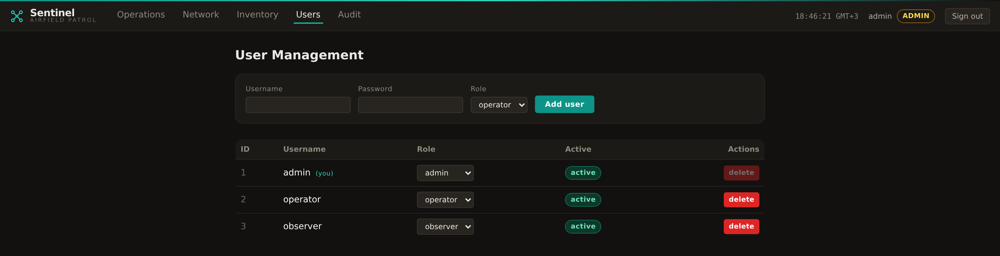

Add users, change roles, delete accounts.
